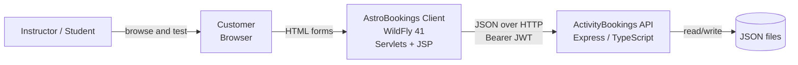
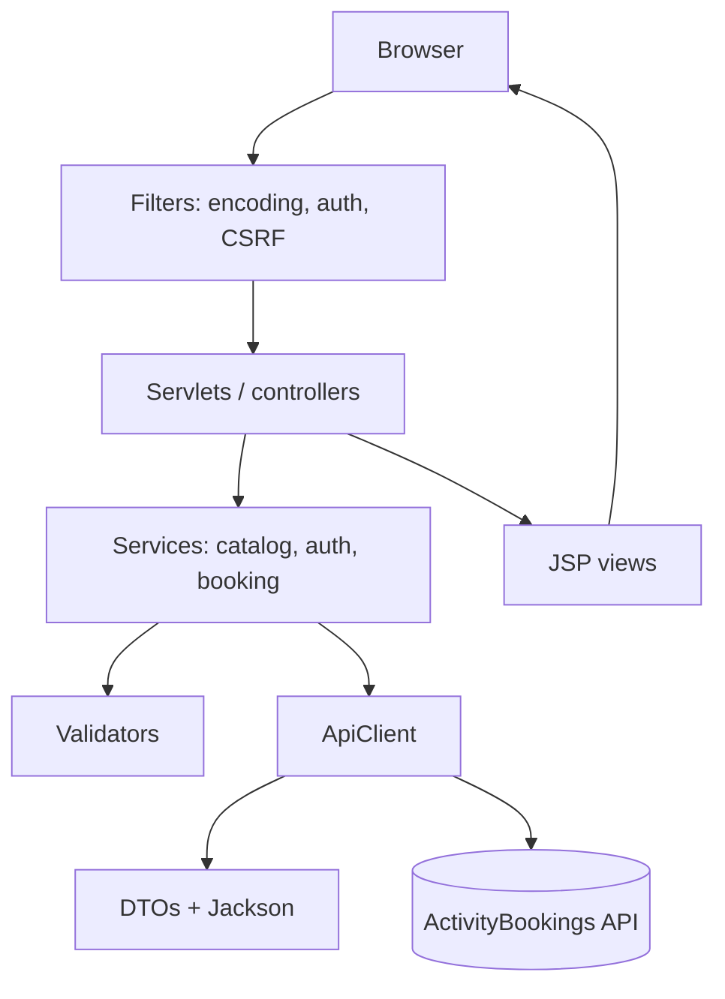

# AstroBookings Client Architectural Design Document

Server-rendered Java web client for the AstroBookings API. Customers browse launches, authenticate, book seats, and review their bookings; the client keeps no database and treats the API as the single source of truth.

### Table of Contents

- [Stack and tooling](#stack-and-tooling)
  - [Technology Stack](#technology-stack)
  - [Development Tools](#development-tools)
- [Systems Architecture](#systems-architecture)
- [Software Architecture](#software-architecture)
  - [Layers and Responsibilities](#layers-and-responsibilities)
  - [Routes and API Mapping](#routes-and-api-mapping)
  - [Folder Structure](#folder-structure)
  - [Session and Security Model](#session-and-security-model)
- [Non-Functional Requirements](#non-functional-requirements)
- [Architecture Decisions Record (ADR)](#architecture-decisions-record-adr)

## Stack and tooling

### Technology Stack

| Concern | Choice |
|---|---|
| Language | Java 27 (records, pattern matching) |
| Runtime | WildFly 41 (Jakarta EE 11) |
| Web | Jakarta Servlet 6.1, JSP 4.0, JSTL 3.0 (`jakarta.*` namespace) |
| Build | Maven 3.9+, WAR packaging, `wildfly-maven-plugin` |
| HTTP client | `java.net.http.HttpClient` (JDK, one instance per app) |
| JSON | Jackson databind 2.x (records, `@JsonIgnoreProperties`) |
| Views | JSP + JSTL + EL, hand-written CSS; no JavaScript framework |
| Validation | Explicit validator classes; no Bean Validation dependency |
| Auth | JWT issued by the API, stored in `HttpSession` |
| Persistence | None; JSON-file API is the only store |
| Logging | SLF4J API with JUL backend; no tokens or passwords logged |
| Testing | JUnit 5 + Mockito + AssertJ, Maven Surefire |

### Development Tools

- JDK 27, Maven 3.9+, WildFly 41, Git, IntelliJ IDEA or VS Code.
- OpenCode agents and skills in `.opencode/` drive the spec-first workflow.
- Workflow: spec → tests → implementation → `mvn test` → `mvn package` → `wildfly:deploy` → verification.
- Local assumption: the ActivityBookings API already runs at `http://localhost:3000`; do not start it.
- No CI pipeline at this stage; the Maven build is the quality gate.

## Systems Architecture

The client is an **API-consuming web application** with server-side rendering. The browser exchanges only HTML and form posts with WildFly; the JWT never reaches the browser. The Java tier adapts HTTP requests to REST calls against the ActivityBookings API, which owns launches, users, and bookings.



Main components:

- **Browser**: renders HTML/CSS, submits forms; holds only the session cookie.
- **Web tier**: servlets, filters, JSP views, session state.
- **Service tier**: use cases (catalog, authentication, booking) and validation.
- **Integration tier**: `ApiClient` plus DTO mapping to the external API.
- **ActivityBookings API**: external system of record, secured by JWT.

Key flows:

1. **Catalog**: `GET /launches` → `CatalogService` → `GET /activities` → JSP list.
2. **Login**: form → `AuthService` → `POST /login` → JWT stored in session → redirect.
3. **Booking**: authenticated form → `AuthFilter` → `BookingService` → `POST /bookings` with bearer token → redirect to `/bookings`.

## Software Architecture

A classic **layered monolith** in a single WAR. Dependencies point downward only: `web → service → integration → config`. JSPs never call services directly; they receive view models as request attributes.



### Layers and Responsibilities

| Layer | Contents | Rules |
|---|---|---|
| `web` | Servlets, filters, view models, `web.xml` | Parse input, call one service, set attributes, forward or redirect. No HTTP calls. |
| `service` | `CatalogService`, `AuthService`, `BookingService` | Own use cases and orchestration. Must not import `jakarta.servlet`. |
| `integration` | `ApiClient`, `ActivityBookingsApi`, DTO records | Own URLs, headers, timeouts, status mapping. No business rules. |
| `validation` | Form validators | Pure functions returning field errors; unit tested. |
| `config` | `AppConfig` | Read env vars and defaults; no magic strings elsewhere. |

Cross-cutting rules:

- Every POST follows **POST → Redirect → GET** with a flash message in session.
- `ApiException(status, message)` carries API failures; 401 clears the session and redirects to `/login?returnUrl=…`.
- 4xx validation errors are shown inline; 5xx and timeouts show `error.jsp` with a retry hint.
- Provider-agnostic: all API access goes through `ApiClient`; nothing else constructs `HttpClient`.
- JSPs use JSTL and EL only — **no scriptlets**; dynamic output escaped with `<c:out>`.
- Unknown JSON fields are ignored so API additions do not break the client.

### Routes and API Mapping

| Client route | Method | API call | Auth |
|---|---|---|---|
| `/` | GET | redirect to `/launches` | No |
| `/launches` | GET | `GET /activities?q=&_sort=&_order=` | No |
| `/launches/{id}` | GET | `GET /activities/{id}` | No |
| `/register` | GET / POST | `POST /users` | No |
| `/login` | GET / POST | `POST /login` | No |
| `/logout` | POST | none (invalidate session) | Session |
| `/bookings` | GET | `GET /bookings?activityId=` | Bearer |
| `/bookings` | POST | `POST /bookings` | Bearer |

Payload assumptions, verified against the API during implementation:

- `POST /users`: `email`, `username`, `password`, `termsAccepted`.
- `POST /login`: returns a JWT in `token`; the client also accepts `accessToken`.
- Activity: `id`, `name`, `slug`, `price`, `date`, `duration`, `location`, `minParticipants`, `maxParticipants`, `status`.
- Booking: `id`, `activityId`, `participants`, `status`, `createdAt`.
- Remaining seats are not exposed; the UI shows `maxParticipants` and relies on API rejection when capacity is exceeded.

### Folder Structure

```text
.
├── pom.xml
├── README.md                  # Course briefing entry point
├── PRD.md                     # Product requirements
├── ADD.md                     # This document
├── AGENTS.md                  # Instructions for AI agents
├── docs/                      # Optional diagrams and notes
├── specs/                     # Feature specs and issue JSON files
└── src
    ├── main
    │   ├── java/com/astrobookings/client
    │   │   ├── config/        # AppConfig
    │   │   ├── web/           # Servlets and view models
    │   │   ├── web/filter/    # Encoding, auth, CSRF filters
    │   │   ├── service/       # Catalog, auth, booking services
    │   │   ├── integration/   # ApiClient, API facade
    │   │   ├── integration/dto# API payload records
    │   │   ├── validation/    # Form validators
    │   │   └── exception/     # ApiException, ValidationException
    │   ├── resources/         # application.properties, log config
    │   └── webapp
    │       ├── WEB-INF/views/ # JSPs and fragments
    │       ├── WEB-INF/web.xml
    │       └── assets/        # CSS, images
    └── test/java/com/astrobookings/client  # JUnit 5 tests
```

### Session and Security Model

- Session attributes: `auth.token`, `auth.email`, `auth.username`, `flash.success`, `flash.error`, `csrf.token`.
- Auth cookie: `HttpOnly`, `SameSite=Lax`, `Secure` outside local development; 30-minute timeout.
- `AuthFilter` guards `/bookings` (server-side check, not UI hiding).
- CSRF synchronizer token required on every POST; token compared in a filter.
- JWT is attached by `ApiClient` as `Authorization: Bearer <token>`; never rendered, logged, or stored in JS.
- Registration and login forms validate email format, password length, and `termsAccepted`.

## Non-Functional Requirements

- **Performance**: catalog and bookings pages render from a single API call; connect timeout 5 s, request timeout 10 s.
- **Reliability**: API failures produce a friendly page, never a stack trace; sessions survive API downtime.
- **Security**: output escaping by default, no secrets in the repository, API base URL from `ASTRO_API_BASE_URL`.
- **Accessibility**: semantic HTML, labeled inputs, keyboard-usable forms, responsive layout without JS.
- **Maintainability**: layer boundaries enforced by package structure and unit tests; one service per use case.

## Architecture Decisions Record (ADR)

### ADR 1: Server-rendered JSP instead of a SPA

- **Decision**: Render HTML on the server with JSP and JSTL; ship no JavaScript framework.
- **Status**: Accepted
- **Context**: The exercise requires a web app written in Java and the audience is evaluating server-side Java skills.
- **Consequences**: Simple deployment and no token exposure to the browser; less interactive UX and no API reuse by third parties.

### ADR 2: Jakarta EE Servlets and JSP on WildFly

- **Decision**: Build a plain Jakarta EE 11 WAR with Servlets, JSP and JSTL, deployed to WildFly 41, instead of Spring Boot.
- **Status**: Accepted
- **Context**: JDK 27 and WildFly 41 are the mandated runtime; the course focuses on web fundamentals rather than framework magic.
- **Consequences**: Full control and small dependency surface; more boilerplate (servlet mappings, filters) and no framework-provided DI.

### ADR 3: JWT stored in the server-side session

- **Decision**: Keep the API JWT in `HttpSession` and never send it to the browser.
- **Status**: Accepted
- **Context**: The API authenticates with bearer tokens, while the client renders HTML forms.
- **Consequences**: Protects the token from XSS and avoids a BFF token endpoint; the app requires sticky sessions and cannot scale horizontally without session replication.

### ADR 4: `java.net.http` plus Jackson for API access

- **Decision**: Centralize calls in `ApiClient` using the JDK HTTP client and Jackson for JSON mapping to records.
- **Status**: Accepted
- **Context**: No Spring or third-party REST client is available by design; records keep DTOs concise.
- **Consequences**: Few dependencies and easy stubbing in tests; manual status/error mapping and explicit DTO maintenance.

### ADR 5: Delegate seat capacity enforcement to the API

- **Decision**: Display `maxParticipants` and let the API reject overbooking; the client only validates `1 ≤ participants`.
- **Status**: Accepted
- **Context**: `GET /activities` does not expose remaining seats, and the API already enforces the rule.
- **Consequences**: No stale availability counters; users discover exhausted seats at submit time until the API exposes availability.

### ADR 6: CSRF synchronizer token on all POSTs

- **Decision**: Issue a per-session token, embed it in every form, and reject mismatches.
- **Status**: Accepted
- **Context**: Session-cookie authentication makes state-changing forms vulnerable to cross-site requests.
- **Consequences**: Small filter and JSP fragment cost; improved safety for the demo without adding production auth complexity.
